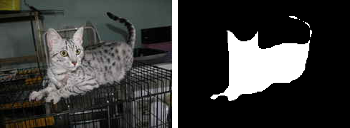

# Day 46 Competition: Shelter Cutouts

**Wednesday 25 November 2026, 10:00 to 16:00 (Riyadh time). 6 hours.** The Vision exam runs before it.

**Join on Kaggle:** https://www.kaggle.com/t/1a6d8fb9c5034ab6bea586e16ae77ad9 (invitation link; sign in with the Kaggle account your instructor linked to your student id, then click Join).

**Competition page:** https://www.kaggle.com/competitions/ai-olympiad-l1-2027-shelter-cutouts

An animal shelter puts a photo of every cat and dog it cares for on its website. Each photo should show the animal alone, cut out from its background.

**Your task:** mark, in each of **1,000 photos**, which pixels belong to the animal, and beat the starter solution. Only **20 photos** come with their masks, and the only pretrained model you may use is one CLIP model.



Everything you need was taught in the Vision block (Days 44 and 45) and in the weeks before it.

## Timeline

| What | Riyadh time (UTC+3) | UTC |
|---|---|---|
| Competition opens, starter notebook and data published | Wed 25 Nov, 10:00 | Wed 25 Nov, 07:00 |
| Competition closes, private leaderboard revealed, notebooks handed in | Wed 25 Nov, 16:00 | Wed 25 Nov, 13:00 |

The clock starts at 10:00 for everybody.

## Files

| File | What it is |
|---|---|
| `train_images/` | 20 photos of cats and dogs, `0.jpg` to `19.jpg` |
| `train_masks/` | their masks, `0.png` to `19.png`: the size of the photo, 255 where the animal is, 0 everywhere else |
| `test_images/` | 1,000 photos, `0.jpg` to `999.jpg`: you make their masks |
| `sample_submission.csv` | the exact shape of the file you upload: `id`, `mask` (it marks every pixel as animal) |

The photos have different sizes; a mask always has the size of its photo. The starter notebook downloads the files from the public Kaggle dataset `sattamjaltwaim/shelter-cutouts` with `kagglehub`; on Colab it needs no Kaggle key. The same files are on the competition's Data tab.

## The starter notebook

[`starter.ipynb`](starter.ipynb) runs from top to bottom as it is. Choose a GPU before you run it (Colab: Runtime, then Change runtime type, then T4 GPU).

1. **Setup:** installs the checkpoint library, opens your session (replace `PASTE-YOUR-ID` with your own student id), imports, downloads the data.
2. **The breeds** of the cats and dogs, and **the model:** the CLIP model `openai/clip-vit-base-patch16`, the only pretrained model this task allows.
3. **Baseline:** for each photo, CLIP picks the breed it looks most like, then every small patch of the photo is compared with that breed's text; the patches most like it are marked as animal. The notebook scores it on the 20 labelled photos, shows one of its masks, then runs it on the test photos (several minutes on a GPU), writes `submission.csv` and checks it with `ck.submit`. Its score is the **baseline**: your points count from it upward.
4. **Your own cells**, then **Finish:** `ck.finish()` hands in your notebook.

Run `ck.submit("submission.csv")` on every file you upload to Kaggle: it checks the file's format and records it.

## Evaluation

The score is the **mean intersection over union (IoU)** of the masks. For every test photo, IoU = (pixels marked in both your mask and the true mask) / (pixels marked in either). The score is the mean over the photos: 1 is perfect.

- The **public leaderboard** scores 40% of the photos and is visible during the competition.
- The **private leaderboard** scores the other 60%. It appears at 16:00 and gives the final ranking.
- The 20 labelled photos are the only masks you have: use them to check your ideas before you spend a submission.

## Submission format

A CSV file with a header line and exactly one row for every test photo, in any order. `id` is the number of the photo's file name (`17.jpg` has id 17). `mask` is a run-length code of the animal pixels: pairs `start length`, with the pixels numbered from 1, row by row (the photo's first row left to right, then the second row, and so on). `3 2 10 4` marks pixels 3, 4, 10, 11, 12 and 13. The starter's `generate_submit` writes the file from your masks.

```
id,mask
0,1203 15 1701 18 2199 20 ...
1,1 106800
...
```

Each time you write a better file, run `ck.submit("submission.csv")` in the notebook **and** upload the file on Kaggle (Submit Prediction). On Colab, download it first from the Files panel (the folder icon on the left, then the three dots beside `submission.csv`, then Download).

## Rules

1. **Solo only.** Every student competes alone: no teams, no merging, one Kaggle account per student, the account linked to your student id by your instructor.
2. **20 submissions per student.** The whole competition sits inside one Kaggle day, so the counter does not reset.
3. **Your own work, without help.** Nobody helps you with the code: not other students, not the instructors. AI assistants (chatbots, and code completion such as Gemini in Colab or Copilot) are switched off for the whole competition.
4. **One pretrained model only.** The only pretrained model you may use is the CLIP model of the starter (`openai/clip-vit-base-patch16`), with any text you like for it. Everything else is allowed: training on the 20 labelled photos, your own small models trained from scratch, NumPy, pandas, scikit-learn, plotting.
5. **No other data.** Use only the files of this competition, and do not search for where the task or the photos come from: other masks of these photos are other data.
6. **20-minute notebook.** Your final notebook, restarted and run from top to bottom, must finish in under 20 minutes (a Colab GPU is fine) and write the file you chose as your final submission. The starter's pass over the test photos is long: delete that cell once you have a file of your own. Your instructor runs your notebook again after the competition; a notebook that cannot reproduce its file does not keep its score.
7. **One final submission.** Before 16:00, on the Submissions page, tick **Use for Final Score** on the file your final notebook writes. If you choose nothing, Kaggle chooses your best public score, which may not be that file.
8. **Hand in your notebook** by running its last cell, `ck.finish()`, before 16:00. A score without a notebook does not count.
9. **Final ranking:** the private leaderboard.
10. **Your student id is yours alone.** Never share a notebook that holds it.

## Getting started

1. Join the competition with the invitation link above. Open the starter in Colab (course website, November Camp, Day 46), choose a GPU, paste your id, and run every cell. Upload its `submission.csv` on Kaggle: you are on the board.
2. Then work as in the case studies: read the statement and the given code, look at the data, list what you notice, and test one idea at a time.

## FAQ

- **Can I train something?** Yes. Rule 4 only limits the pretrained models to the one CLIP; anything you train yourself on the 20 labelled photos is allowed.
- **Do I need a GPU?** For the starter's pass over the test photos, yes (Colab: Runtime, then Change runtime type, then T4 GPU). Without one it takes hours.
- **The checkpoint says my file is fine, but where is my score?** The score comes from Kaggle: upload the same file there.

## Licence

The photos are from the Oxford-IIIT Pet dataset by O. M. Parkhi, A. Vedaldi, A. Zisserman and C. V. Jawahar (Cats and Dogs, CVPR 2012), licence CC BY-SA 4.0. They were renamed, and the masks of the 20 labelled photos are made from the dataset's annotations. The competition data is shared under the same licence.
